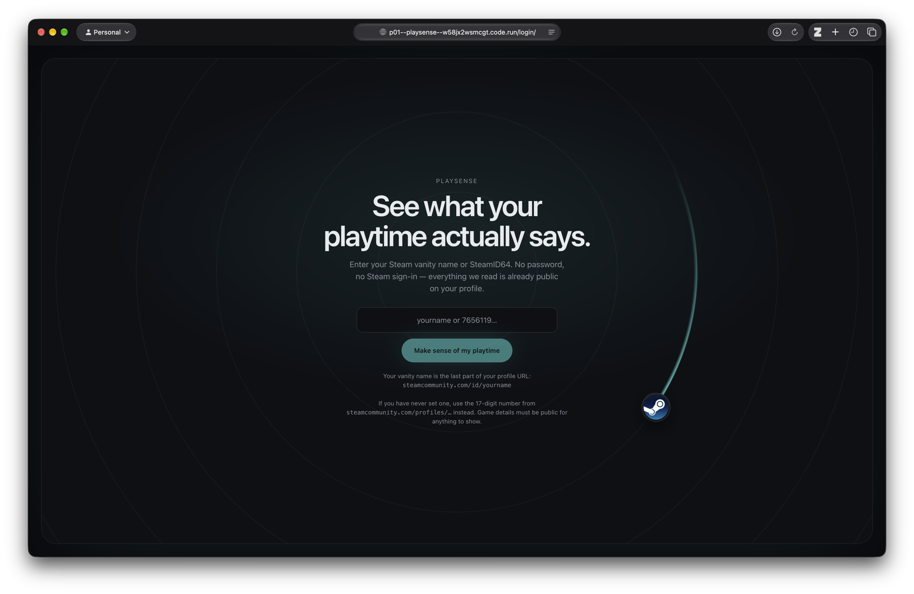
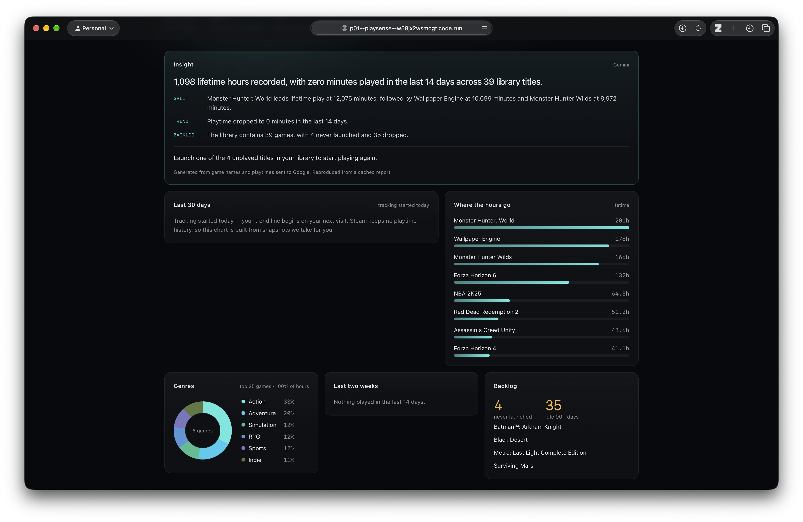

# PlaySense

**Your Steam playtime, and what it says about you.**

Type your Steam name, get one number, one trend line, and a plain-language read on where the hours went. No Steam login, no password, nothing to install.

### [**Try it live →**](https://p01--playsense--w58jx2wsmcgt.code.run/)



## What you get

- **The number that matters** — hours played in the last 30 days, next to your lifetime total.
- **A trend that actually means something** — Steam keeps no playtime history, so PlaySense records its own snapshots of your library and diffs them. Every line and total is built from those deltas.
- **Where the hours went** — your top games, your genre split, and the share of your life one game has quietly eaten.
- **What each game cost you per hour** — the current Steam store price against lifetime hours, with the best and worst value among your most-played games. The current price, not what you paid.
- **The backlog** — games you own and never launched, plus the ones you dropped 90 days ago.
- **A verdict** — a short Insight Report in plain language, generated from your stats and cached so the same numbers never cost a second request.
- **Nothing to trust it with** — read-only, no Steam credentials, no password.

## How it works

```
Browser ──► Next.js static export (served by Spring Boot) ──► Spring Boot API ──► Steam Web API
                    same origin, httpOnly cookie                 │                Store appdetails
                                                                └──► Gemini (optional, cached)
                                                                └──► Postgres (Neon)
```

One process serves the UI, the API and the cookie. The interesting constraint is that Steam exposes **no playtime history** — so the trend is not a Steam feature, it's this service remembering what your library looked like yesterday. Read more in `docs/adr/0001`.

## No Steam login. On purpose.

You identify yourself by the Steam vanity name or 17-digit SteamID64 that's already public. PlaySense resolves it through the Steam Web API, sets an httpOnly cookie, and reads your library. It never asks for a password and never writes anything to Steam.

The trade is honest: anyone who knows that SteamID can open the same dashboard. Nothing shown here is private that Steam isn't already publishing — which is also why a private library sends you to a page explaining that, instead of a broken chart. See `docs/adr/0004`.



## The Insight Report

It's text generated from your statistics and validated against a fixed schema, cached against a hash of the stats it describes. Without a Gemini key the app is fully functional: the same report is filled deterministically from a template, and only the attribution line changes. When Gemini is on, game names and playtimes go to Google; that line is shown under the report. See `docs/adr/0003`.

## Run it locally

You need Docker.

**Everything in containers**

```bash
cp .env.example .env        # add STEAM_API_KEY and, optionally, GEMINI_API_KEY
docker compose up --build   # http://localhost:8080
```

**Frontend hot reload against the containerised API**

```bash
docker compose up -d db api
cd frontend && npm install && npm run dev   # http://localhost:3000
```

`next dev` proxies `/api/*` to `localhost:8080`. The session cookie ignores ports, so signing in on either origin works for both.

Get a Steam key at <https://steamcommunity.com/dev/apikey>. Without a Gemini key the Insight Report comes from the template fallback.

## Deploy

The repo builds to a single Docker image: Next.js exported to static files, served by Spring Boot, with Flyway migrating on start. This one runs on Northflank; nothing in the image is host-specific.

| Variable | Needed | Notes |
|---|---|---|
| `DATABASE_URL` | yes | `jdbc:postgresql://host:5432/db` |
| `DB_USER`, `DB_PASSWORD` | yes | Default to `playsense` for local compose |
| `STEAM_API_KEY` | yes | Without it there is nothing to fetch |
| `GEMINI_API_KEY` | no | Enables the generated Insight Report |
| `GEMINI_MODEL` | no | Defaults in `application.yml` |
| `COOKIE_SECURE` | on HTTPS | `true` so the session cookie is `Secure` |
| `PORT` | no | Defaults to `8080` |

Use a Postgres that keeps its data. Hosted free databases that expire take your snapshot history with them, and the history is the product.

## Endpoints

| Method | Path | Purpose |
|---|---|---|
| POST | `/api/session` | Resolve a vanity name or SteamID64, start a session |
| DELETE | `/api/session` | Forget the session |
| GET | `/api/me` | Current player |
| GET | `/api/dashboard` | Everything the page needs, one call |
| POST | `/api/refresh` | Re-poll Steam (60s floor) |

`GET /api/dashboard` returns `player`, `hero`, `split`, `trend`, `recent`, `backlog`, `insight`, `meta`. When `meta.libraryPrivate` is true the rest is null and the UI sends you to `/private`.

## Layout

```
frontend/     Next.js 16 App Router, static export, plain CSS
backend/      Spring Boot 3.3, JdbcClient (no JPA), Flyway
Dockerfile    node build → maven build → JRE
docs/adr/     five decisions worth reading before you change this
```

Backend tests: `docker run --rm -v "$PWD/backend":/app -w /app maven:3.9-eclipse-temurin-21 mvn test`

## The words the code uses

`GLOSSARY.md` is the vocabulary — Player, Library, Playtime Snapshot, Playtime Delta, Hero stat, Backlog, Insight Report, Coverage — each with the terms the code deliberately avoids.
